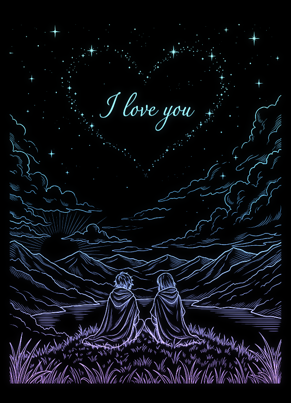
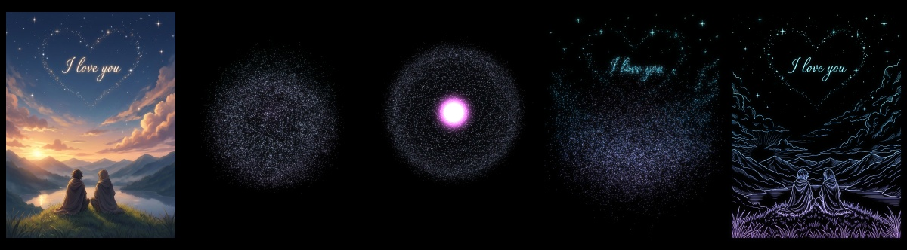
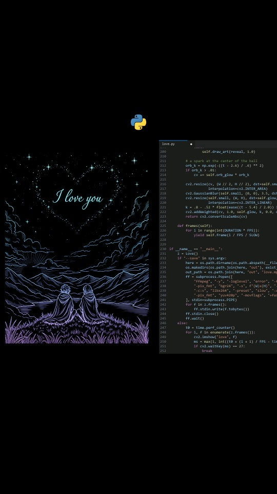

# particle-love

A twilight scene under a starry heart that breaks into 15,000 particles and puts itself back together.

`love.py` opens on the original scene (`love_ref.jpg`) and animates the line engraving (`love.png`) with NumPy and OpenCV.

<p align="center">
  
</p>

## What happens



1. The original scene is on screen for the first second.
2. It shatters and the particles collapse into a spinning sphere.
3. A flash of light at the center of the sphere.
4. Every particle flies back to its own spot on the drawing.
5. A bright line sweeps down and lights the drawing up in a cyan to violet gradient.

The whole thing runs for 14 seconds at 60 FPS.

## Run it

Double-click `start.bat` on Windows (or run `python start.py`) to install dependencies automatically and choose a mode, or run manually:

```bash
pip install -r requirements.txt
python love.py           # live window, ESC to quit
python love.py --save    # writes out/love.mp4
```

## Vertical video

`make_reel.py` renders a 1080x1920 video with the animation on the left and the source scrolling on the right.

<p align="center">
  
</p>

```bash
python make_reel.py         # out/love_reel.mp4
```

It pipes frames into `ffmpeg`, so that needs to be on your PATH. The code panel uses Consolas from the Windows fonts folder; change `FONT` in `make_reel.py` on macOS or Linux.

## Settings

At the top of `love.py`:

| Setting | What it does |
|---|---|
| `N` | number of particles |
| `FPS` | frame rate |
| `DURATION` | length in seconds |
| `SLOW` | stretches or squeezes the timing |
| `TOP`, `MID`, `BOT` | gradient colors (BGR) |
| `ORB` | color of the flash |
| `IMAGE` | line engraving used for particles and reveal |
| `REF` | opening color image |

## License

MIT
